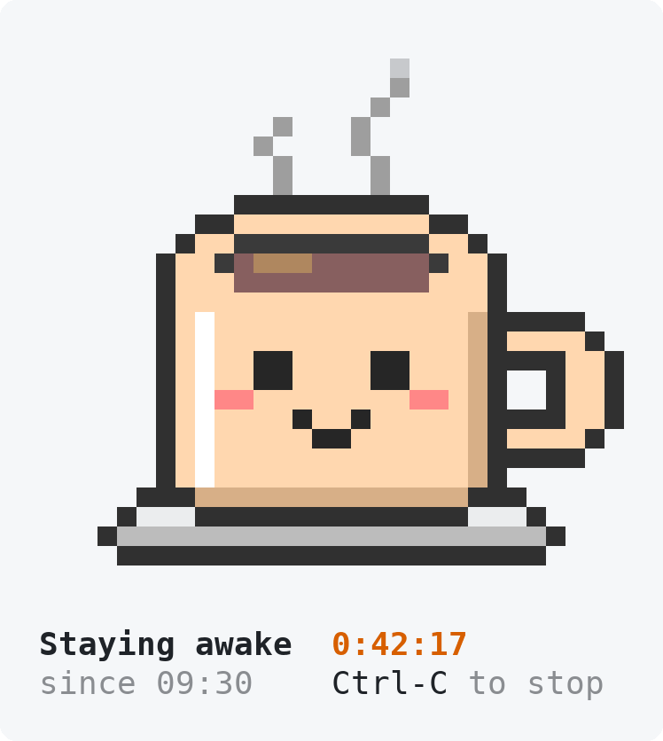

# coffee

Keep your Mac awake from the terminal, with a happy cup of coffee for company.

<p align="center">
  <picture>
    <source media="(prefers-color-scheme: dark)" srcset="docs/coffee-dark.gif">
    
  </picture>
</p>

`coffee` runs macOS's own `caffeinate -dimsu` for as long as it's open, with a little animated cup and a timer to show it's working. Press Ctrl-C and your Mac can sleep again.

## Install

```sh
curl -fsSL https://github.com/ptmplop/coffee/releases/latest/download/install.sh | bash
```

The installer puts `coffee` in the first of `~/.local/bin`, `~/bin`, `/usr/local/bin` and `/opt/homebrew/bin` that's on your PATH and writable. If none is, it uses `~/.local/bin` and tells you the line to add to your PATH. It never uses sudo. Run it again to update.

Or by hand:

```sh
curl -fsSL --create-dirs -o ~/.local/bin/coffee https://github.com/ptmplop/coffee/releases/latest/download/coffee && chmod +x ~/.local/bin/coffee
```

## Use

```sh
coffee
```

Leave it running for as long as you need the Mac awake, and press Ctrl-C when you're done.

- It keeps the display, disks and system awake, the same as `caffeinate -dimsu`.
- Nothing is left behind. Quit it, close the window or kill it, and caffeinate goes too.
- It fits the window: a bigger cup in big windows, a line-art cup in small ones, just the timer in tiny ones.
- It works on light and dark terminals. `NO_COLOR=1 coffee` draws it without colour.
- Ctrl-Z and `fg` hand the terminal back and forth.

## Requirements

macOS. Nothing else to install: `coffee` is a single bash script that runs on the bash 3.2 that ships with macOS.

## Uninstall

```sh
rm "$(command -v coffee)"
```

## Licence

[MIT](LICENSE)
